# KRISHIMA — Conceptual Database Model & ER Diagram

- **Version:** 1.0 (Phase 0)
- **Owner:** Database Architect
- **Status:** Conceptual (physical schema implemented in Phase 1+ via migrations)
- **Companions:** [System Design](../architecture/01-system-design.md) · [Permission Matrix](../product/02-account-permission-matrix.md) · [ADR-0002](../adr/0002-uuid-identifiers.md) · [ADR-0006](../adr/0006-migrations-alembic-supabase.md)

---

## 1. Modelling Standards (mandatory)

| Rule | Standard |
|------|----------|
| **Schema** | Supabase `auth` schema untouched; application tables in `app` schema (or `public` with prefix — decided at Phase 1; default `app`). |
| **PK type** | `uuid` generated in app as **UUIDv7** (`gen_uuid_v7()` helper / Python lib). |
| **Timestamps** | `created_at`, `updated_at` `timestamptz not null default now()` (UTC). `deleted_at` for soft delete where audit/legal retention requires. |
| **Money** | `numeric(14,2)` INR columns named `*_amount`, plus `currency char(3) default 'INR'`. **Never float.** |
| **Quantity** | `numeric(14,3)` + `unit` enum (`kg, quintal, tonne, litre, unit, acre, hour, day`). |
| **Enums** | Postgres `enum` types or `text` + `check` for state; state columns documented per table. |
| **FKs** | Every FK constrained; `on delete restrict` by default, `cascade` only for pure child rows (e.g., order_items). |
| **Uniqueness** | Business keys get unique (partial where soft-delete applies). |
| **Idempotency** | `idempotency_key` unique per scope where duplicates are possible. |
| **Tenancy** | Every tenant-owned row has `workspace_id` (owner workspace) → enables RLS + partitioning. |
| **Audit** | `created_by`, `updated_by` (user id) on mutable business tables. |
| **Indexing** | FK columns indexed; composite indexes for common filters (workspace_id, status, created_at desc). |
| **No destructive changes** | Drops/type changes require explicit authorization + documented rollback. |
| **PII** | Identity numbers stored hashed or encrypted (not plaintext where avoidable); full values only in private storage, access logged. |

---

## 2. Domain Groupings

```
IDENTITY          users, role_assignments, organizations, organization_members,
                  invitations, staff_roles, staff_role_assignments
KYC               kyc_profiles, kyc_documents, kyc_reviews
CATALOG           categories, listings, listing_media, (products optional)
ORDERS            orders, order_items, payments, refunds, invoices
LABOUR            jobs, job_applications, engagements
EQUIPMENT         equipment, equipment_bookings
LOGISTICS         transport_requests, shipments
STORAGE           warehouses, storage_bookings, stock_movements
CONTENT           content_items, content_categories
CROSS-CUTTING     notifications, notification_preferences, audit_log,
                  outbox_events, idempotency_keys, attachments
```

---

## 3. ER Diagram (Mermaid, conceptual)

> Read this as the **logical** model. Physical tables add audit/timestamp columns and
> constraints described in §4/§5. `uuid` PKs throughout.

```mermaid
erDiagram
    USERS ||--o{ ROLE_ASSIGNMENTS : has
    USERS ||--o{ ORGANIZATION_MEMBERS : joins
    USERS ||--o| KYC_PROFILES : has
    USERS ||--o{ NOTIFICATIONS : receives
    USERS ||--o{ NOTIFICATION_PREFERENCES : sets

    ORGANIZATIONS ||--o{ ORGANIZATION_MEMBERS : has
    ORGANIZATIONS ||--o| KYC_PROFILES : owns
    ORGANIZATIONS ||--o{ INVITATIONS : issues
    ORGANIZATIONS ||--o{ LISTINGS : owns

    ROLE_ASSIGNMENTS }o--|| ROLES : references
    USERS ||--o{ STAFF_ROLE_ASSIGNMENTS : may_hold
    STAFF_ROLE_ASSIGNMENTS }o--|| STAFF_ROLES : references

    KYC_PROFILES ||--o{ KYC_DOCUMENTS : contains
    KYC_PROFILES ||--o{ KYC_REVIEWS : reviewed_by

    CATEGORIES ||--o{ LISTINGS : classifies
    LISTINGS ||--o{ LISTING_MEDIA : has
    LISTINGS ||--o{ ORDER_ITEMS : referenced_by

    ORDERS ||--|{ ORDER_ITEMS : contains
    ORDERS ||--o{ PAYMENTS : paid_by
    ORDERS ||--o{ REFUNDS : refunded_by
    ORDERS ||--o| INVOICES : has

    LISTINGS ||--o{ JOBS : "n/a (jobs standalone)"
    JOBS ||--o{ JOB_APPLICATIONS : receives
    JOB_APPLICATIONS ||--o| ENGAGEMENTS : becomes

    EQUIPMENT ||--o{ EQUIPMENT_BOOKINGS : booked
    WAREHOUSES ||--o{ STORAGE_BOOKINGS : booked
    WAREHOUSES ||--o{ STOCK_MOVEMENTS : records

    TRANSPORT_REQUESTS ||--o| SHIPMENTS : fulfilled_by

    CONTENT_CATEGORIES ||--o{ CONTENT_ITEMS : classifies
    USERS ||--o{ CONTENT_ITEMS : authored

    USERS ||--o{ AUDIT_LOG : acted
    OUTBOX_EVENTS }o--|| ORDERS : "produced by (polymorphic subject)"
```



*Polymorphic links (`subject_type`/`subject_id` in notifications, audit_log, outbox_events,
attachments) are intentional (shown as `}` links, not FK-enforced, to avoid table explosion);
integrity enforced in application layer + documented.*

---

## 4. Entity Specifications

Legend: **PK** primary key · **FK** foreign key · **UQ** unique · **IX** index · **CK** check.
All tables implicitly have `id uuid PK default gen_uuid_v7()`, `created_at`, `updated_at`.

### 4.1 Identity

**users** — mirrors `auth.users`
| Column | Type | Constraints |
|--------|------|-------------|
| auth_uid | uuid | UQ, not null — links to Supabase `auth.users.id` |
| full_name | text | |
| email | citext | UQ (partial, not soft-deleted) |
| phone | text | UQ (partial) — stored E.164 |
| locale | text | default 'en-IN' |
| timezone | text | default 'Asia/Kolkata' |
| status | text | CK ∈ {active, suspended, deletion_pending, deleted} |
| deleted_at | timestamptz | |
Notes: never stores password; AuthN is Supabase's job.

**roles** — catalog of marketplace roles (`farmer`, `buyer`, …). Seeded, not user-editable.

**role_assignments** — the multi-role core
| Column | Type | Constraints |
|--------|------|-------------|
| user_id | uuid FK users | not null |
| role_id | uuid FK roles | not null |
| scope_type | text | CK ∈ {personal, organization} |
| organization_id | uuid FK organizations | null iff scope=personal |
| status | text | CK ∈ {pending_kyc, active, suspended, revoked} |
| granted_at / revoked_at | timestamptz | |
| | | UQ(user_id, role_id, scope_type, coalesce(organization_id,'000…')) |

**organizations**
| Column | Type | Constraints |
|--------|------|-------------|
| name / legal_name | text | not null |
| gstin / pan | text | UQ partial, CK format (nullable until KYC) |
| status | text | CK ∈ {active, suspended, deleted} |

**organization_members**
| user_id, organization_id | FKs | UQ(user_id, organization_id) |
| org_role | text | CK ∈ {owner, admin, manager, staff, viewer} |
| status | text | CK ∈ {invited, active, removed} |

**invitations**
| organization_id, email/phone, invited_role(s) | | token_hash (UQ), expires_at, accepted_at, single-use |
| status | text | CK ∈ {pending, accepted, expired, revoked} |

**staff_roles**, **staff_role_assignments** — mirror the same shape but platform-scoped
(no organization), with `super_admin` break-glass flag.

### 4.2 KYC

**kyc_profiles** — one per user-or-organization
| Column | Type | Constraints |
|--------|------|-------------|
| subject_type | text | CK ∈ {user, organization} |
| subject_id | uuid | UQ(subject_type, subject_id) |
| status | text | CK ∈ {not_started, pending, in_review, verified, rejected} |
| verified_at / rejected_reason | | |

**kyc_documents** — private bucket references (never raw public URL)
| kyc_profile_id FK, doc_type (CK enum), storage_path, checksum, uploaded_at |
| status | CK ∈ {uploaded, approved, rejected} |

**kyc_reviews** — decision audit: kyc_profile_id FK, reviewer_user_id FK, decision, notes, decided_at. Append-only.

### 4.3 Catalog

**categories** — tree: id, parent_id FK self, slug UQ, name JSONB (i18n), kind CK ∈ {produce, input, equipment, service}.

**listings**
| Column | Type | Constraints |
|--------|------|-------------|
| workspace_id | uuid | not null, IX — owner workspace (personal or org) |
| seller_user_id | uuid FK users | not null |
| category_id | uuid FK categories | not null |
| kind | text | CK ∈ {produce, input, equipment_capacity, storage_capacity, transport_capacity} |
| title / description | text | |
| quantity / unit | numeric(14,3) / unit enum | CK quantity > 0 |
| price_amount / currency | numeric(14,2) / char(3) | CK price >= 0 |
| location_pincode / lat / lng | text / numeric | IX on (pincode), geo index later |
| available_from / available_to | timestamptz | CK to > from |
| status | text | CK ∈ {draft, active, paused, sold_out, expired, archived} |
| published_at | timestamptz | |
IX: (workspace_id, status), (category_id, status), (pincode, status).

**listing_media** — listing_id FK, storage_path, position, alt_text (i18n JSONB).

### 4.4 Orders & Payments

**orders**
| Column | Type | Constraints |
|--------|------|-------------|
| order_no | text | UQ — human reference |
| buyer_workspace_id / buyer_user_id | uuid | not null |
| seller_workspace_id / seller_user_id | uuid | not null |
| status | text | CK ∈ {draft, placed, confirmed, in_fulfilment, fulfilled, cancelled, disputed} |
| total_amount / currency | numeric(14,2) | not null |
| idempotency_key | text | UQ |
| placed_at / cancelled_at | | |
IX: (buyer_workspace_id, created_at desc), (seller_workspace_id, created_at desc), (status).

**order_items** — order_id FK (cascade), listing_id FK, **snapshot**: title, unit_price,
quantity, unit, line_total. *(Immutable after order placed — price snapshot, FR-ORD-1.)*
CK line_total = unit_price*quantity (rounded per policy).

**payments**
| Column | Type | Constraints |
|--------|------|-------------|
| order_id | uuid FK orders | not null |
| provider | text | not null |
| provider_reference | text | **UQ** — prevents duplicate capture |
| amount / currency | numeric(14,2) | CK amount > 0 |
| status | text | CK ∈ {initiated, authorised, captured, failed, cancelled} |
| idempotency_key | text | UQ |
| captured_at | | |
IX: (order_id, status).

**refunds** — payment_id FK, amount, reason, status, approved_by_user_id, initiated_by_user_id
CK: `approved_by <> initiated_by` when amount > threshold (four-eyes, FR/threat TM-13).
CK invariant (enforced in service + trigger): Σ refunds ≤ captured amount.

**invoices** — order_id FK UQ, invoice_no UQ, pdf storage path, issued_at.

### 4.5 Labour

**jobs** — employer_workspace_id, employer_user_id, title, description, location, start_at,
end_at (CK end>start), wage_amount numeric(14,2), wage_unit CK ∈ {per_day, per_hour, per_task},
workers_needed int CK>0, status CK ∈ {draft, open, filled, closed, cancelled}.

**job_applications** — job_id FK, worker_user_id FK, status CK ∈ {applied, accepted, rejected, withdrawn},
message. **UQ(job_id, worker_user_id)** — one live application per pair.

**engagements** — job_id FK, worker_user_id FK, application_id FK UQ, status CK ∈ {active, completed, cancelled},
wage_agreed numeric. **UQ(job_id, worker_user_id)** — no duplicate engagement.

### 4.6 Equipment

**equipment** — owner_workspace_id, owner_user_id, category, name, hourly_rate/daily_rate
numeric(14,2), location, status CK ∈ {draft, active, paused, archived}.

**equipment_bookings**
| equipment_id, renter_workspace_id, renter_user_id, start_at, end_at (CK end>start), total_amount, status CK ∈ {requested, confirmed, declined, cancelled, completed}, idempotency_key UQ |
**Exclusion constraint:** `EXCLUDE USING gist (equipment_id WITH =, tstzrange(start_at,end_at) WITH &&)` for statuses in (requested, confirmed) → **prevents overlapping bookings at DB level** (FR-EQP-2).

### 4.7 Logistics

**transport_requests** — requester_workspace_id, pickup_location, drop_location, goods_desc,
weight numeric, ready_at, status CK ∈ {open, matched, in_transit, delivered, cancelled}.

**shipments** — transport_request_id FK UQ (one shipment per request), transporter_workspace_id,
vehicle_ref, status CK ∈ {assigned, picked_up, in_transit, delivered, failed}, delivered_at.

### 4.8 Storage

**warehouses** — operator_workspace_id, name, location, capacity_tonnes numeric, rate_per_unit,
commodities JSONB, status.

**storage_bookings** — warehouse_id, customer_workspace_id, start_at/end_at, quantity, unit,
commodity, status CK ∈ {requested, confirmed, active, completed, cancelled}, idempotency_key UQ.
Exclusion constraint on capacity is **approximated via service-level check + advisory lock**
(capacity is sum-based, not range-only) — noted as a known limitation.

**stock_movements** — warehouse_id, booking_id, direction CK ∈ {in, out, adjustment},
quantity, unit, occurred_at. Append-only ledger; balance derived, never mutated.

### 4.9 Content

**content_categories** — slug UQ, name JSONB.
**content_items** — author_user_id, category_id, title, slug UQ, body (sanitized HTML/Markdown),
media links, status CK ∈ {draft, in_review, published, rejected, archived}, published_at,
moderated_by_user_id, locale.

### 4.10 Cross-cutting

**notifications** — recipient_user_id, channel CK ∈ {in_app, sms, email}, template_key,
subject_type/subject_id (polymorphic), payload JSONB (**no sensitive data**), status CK ∈ {pending, sent, failed, read}, read_at.

**notification_preferences** — user_id UQ per channel/category, enabled bool, locale.

**audit_log** — *append-only*
| actor_user_id (nullable for system), actor_role, action (e.g., `kyc.decide`),
target_type/target_id (polymorphic), result CK ∈ {success, denied, error},
ip_hash, user_agent_hash, correlation_id, metadata JSONB (**scrubbed, no PII/secrets**), created_at |
No UPDATE/DELETE grants; RLS read restricted to `audit.read`.

**outbox_events** — event_type, aggregate_type/aggregate_id, payload JSONB, status CK ∈
{pending, processing, done, failed, dead}, attempts int, available_at, last_error, processed_at.
IX (status, available_at).

**idempotency_keys** — scope (route), user_id, key, request_hash, response_status, response_body
JSONB, created_at, expires_at. UQ(scope, user_id, key).

**attachments** — generic: owner_type/owner_id, storage_path, mime, size, checksum, visibility CK ∈ {public, private}.

---

## 5. Constraint Summary (the "prevent duplicates" contract)

| Requirement | Mechanism |
|-------------|-----------|
| No duplicate order on retry | `orders.idempotency_key` UQ + idempotency middleware |
| No duplicate payment capture | `payments.provider_reference` UQ + UQ idempotency_key |
| No refund over captured | service check + trigger (Phase 4) |
| No overlapping equipment booking | Postgres `EXCLUDE` (gist) constraint |
| No duplicate application/engagement | UQ(job_id, worker_user_id) |
| No duplicate org membership | UQ(user_id, organization_id) |
| No duplicate listing slug (content) | UQ slug |
| One closed KYC profile per subject | UQ(subject_type, subject_id) |
| Wallet/balance integrity (storage) | append-only stock_movements ledger |

---

## 6. RLS Policy Sketch (per table, applied Phase 2)

```sql
-- Example: listings
alter table app.listings enable row level security;
create policy listings_select_public on app.listings
  for select using (status = 'active' or workspace_id = current_setting('app.current_workspace_id')::uuid);
create policy listings_write_own on app.listings
  for all using (workspace_id = current_setting('app.current_workspace_id')::uuid)
  with check (workspace_id = current_setting('app.current_workspace_id')::uuid);
```
- `app.current_user_id`, `app.current_workspace_id` set per request in the DB session.
- Staff/admin policies authorize via a `app.is_staff()` function checking staff assignments.
- Every RLS policy is covered by an automated cross-workspace leak test.

---

## 7. Partitioning Readiness

Tables designed to grow with users (`audit_log`, `notifications`, `orders`, `outbox_events`,
`stock_movements`) include `created_at` in the PK order / are declared with `PARTITION BY RANGE
(created_at)` in physical DDL when volume justifies (Phase ≥4). No domain change required.

## 8. Out of Scope / Deferred

- Full geo index (PostGIS) — deferred to search phase (A-08).
- Multi-currency — INR only (A-03).
- Payout/settlement tables for creators & transporters — deferred.

## 9. Open Questions for DB

See [OPEN-QUESTIONS.md](../OPEN-QUESTIONS.md) Q-DB-1 (schema name `app` vs `public`), Q-DB-2
(PII encryption approach), Q-DB-3 (soft-delete retention policy).
